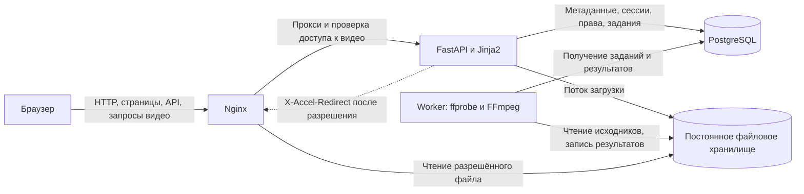
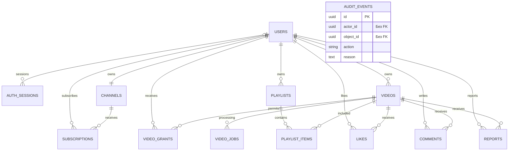
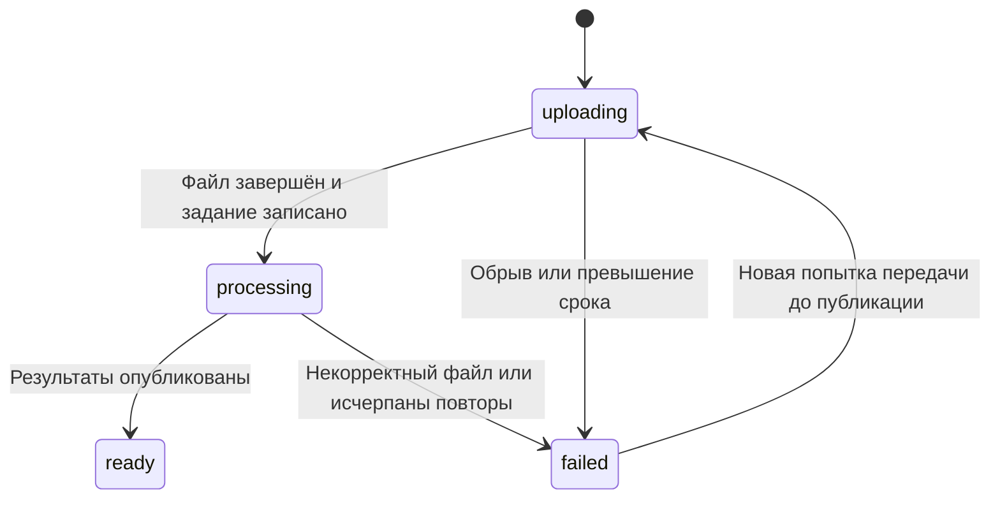

# Архитектура видеоплатформы

Версия 0.13. Архитектурный план MVP на основании [требований](requirements.md).
Документ описывает существующую основу и целевую систему. Проектные решения
о развёртывании реализованы на этапе 11; публичный домен, внешний сервер
и systemd на отдельной VM требуют приёмки в целевой инфраструктуре.

## 1. Состояние реализации

| Компонент | Сейчас | Целевая версия MVP |
| --- | --- | --- |
| HTTP и страницы | FastAPI, Jinja2, главная, авторизация, `/studio` с метаданными/grants/удалением, `/upload` с прогрессом, `/watch/{id}` с плеером | Все экраны из требований |
| Авторизация | Регистрация, вход, выход, сессии, CSRF, лимиты, зависимости проверки ролей | Подключение проверок ко всем предметным операциям |
| Пользователи | `users`, роли user/moderator/admin, канал при регистрации, CLI создания администратора | Поиск пользователей, назначение ролей и аудит реализованы |
| База | PostgreSQL, SQLAlchemy, Alembic; очередь Procrastinate в video_queue; upload_attempts и резерв квот | Видеокаталог, социальные функции, рабочая очередь и аудит |
| Файлы | Потоковая загрузка, UUID-исходники на постоянном volume, аренды, очистка | Закрытое хранилище исходников и производных файлов |
| Обработка видео | Worker Procrastinate, ffprobe/FFmpeg, поколения, аренды, повторы и recovery | Отдельный worker с FFmpeg/ffprobe |
| Раздача видео | ACL в FastAPI, MP4/JPEG через internal Nginx, Range, no-store | Проверка доступа в FastAPI, передача файла Nginx |
| Каталог и каналы | Публичная лента и поиск, каналы с ACL, описание, подписки и свой список подписок | Плейлисты на канале |
| Взаимодействия | Лайки, текстовые комментарии, пагинация и удаление своего комментария с ACL видео | Базовая функция MVP реализована |
| Плейлисты | Публичные списки на канале и `/playlists/{id}`, свой экран, порядок и счётчики с ACL | Базовая функция MVP реализована |
| Модерация и аудит | Жалобы, очередь, обязательные причины, скрытие/восстановление и атомарный аудит | Аудит модерации и назначения ролей реализован |
| Запуск | Ubuntu bootstrap, production HTTPS/ACME, age + SSH backup, restore, локальный CLI диагностики | Проверка на целевом сервере и публичный выпуск |

Модерация доступна moderator/admin, управление пользователями и история ролей —
только admin. Nginx ограничивает
обычные запросы 1 MiB, content — MAX_UPLOAD_BYTES, без request buffering.

## 2. Компоненты и связи

Выбираем модульный монолит: одна кодовая база, единые миграции и отдельные
процессы HTTP-приложения и фонового обработчика. Для MVP нужны пять компонентов:
Nginx, FastAPI, worker, PostgreSQL и файловое хранилище.



Эта схема работает в локальном Compose: загрузка → обработка → защищённое
воспроизведение. Production overlay добавляет HTTPS и ACME; эксплуатация
описана в [инструкции оператора](deployment.md).

- Nginx завершает HTTPS, ограничивает запросы, отдаёт статику и разрешённые файлы.
- FastAPI обслуживает страницы и API, проверяет сессию, роль и права на объект.
- Worker выполняет тяжёлую обработку, восстановление заданий и очистку файлов.
- PostgreSQL хранит предметные данные и устойчивую очередь заданий.
- Файловое хранилище содержит байты видео и превью; в БД находятся их ключи.

Очередь в PostgreSQL позволяет записать видео и задание одной транзакцией.
Дополнительный брокер сообщений в MVP не требуется. Переход к нему допустим
после измерения нагрузки и появления конкретной причины.

На этапе 1 выбран Procrastinate 3.11.0: проверены общая транзакция SQLAlchemy/
psycopg и явное восстановление после SIGKILL. [ADR 0001](decisions/0001-postgresql-queue.md)
описывает результаты и обязательный recovery-проход. Схема и worker установлены
на этапах 3–4. Поля jobs ниже обозначают логические требования,
а не дополнительную очередь рядом с библиотечной. Domain attempt token остаётся
необходимым для защиты публикации устаревших результатов.

## 3. Модули и ответственность

| Модуль | Отвечает за | Основные зависимости |
| --- | --- | --- |
| auth | Пароли, сессии, CSRF, текущий пользователь, роли | БД и настройки |
| channels | Профиль автора и подписки | Пользователи |
| videos | Метаданные, загрузка, состояния, выдача и отзыв доступа | auth, storage, jobs |
| catalog | Главная, поиск, выдача канала | Запросы к videos и общая политика видимости |
| playlists | Плейлисты и порядок элементов | Пользователи, политика видимости videos |
| interactions | Лайки и комментарии | Пользователи, политика просмотра videos |
| moderation | Жалобы, решения, скрытие, восстановление | auth, videos, audit |
| audit | Запись событий в транзакции вызывающего кода, чтение истории | БД, общая пагинация |
| administration | Назначение ролей с аудитом | auth, пользователи |
| storage | Безопасные ключи, запись, переименование, удаление файлов | Локальная файловая система |
| jobs | Очередь, аренда задания, повторы, heartbeat | PostgreSQL |

HTTP-обработчик разбирает запрос, вызывает прикладную операцию и формирует ответ.
Прикладная операция проверяет правила, задаёт границу транзакции и обращается
к SQLAlchemy и storage. Worker вызывает те же операции публикации результата,
а не воспроизводит правила HTTP-обработчика.

Политика просмотра общая для API, страниц, каталога и плейлистов. Worker использует
общие правила публикации результата и удаления, а не права конкретного зрителя.
Роль и владение — разные проверки. Модули не меняют таблицы друг друга в обход
прикладных операций. Репозитории-обёртки над каждым SQLAlchemy-запросом не обязательны.

Целевая организация кода по мере роста:

```text
app/
  main.py, application.py, config.py, db.py
  modules/
    auth/              router, schemas, service, models
    channels/          router, schemas, service, models
    videos/            router, schemas, service, models, access
    catalog/           router, queries
    playlists/         router, schemas, service, models
    interactions/      router, schemas, service, models
    moderation/        router, schemas, service, models
    administration/    router, schemas, service
  storage/             файловые операции
  jobs/                модели очереди, получение и завершение заданий
  worker.py            запуск обработчика
  templates/, static/
migrations/, tests/, deploy/, scripts/, docs/
```

Это план структуры, а не уже существующие каталоги. Текущие `app/api/auth.py`,
`app/models.py`, `auth_dependencies.py`, `auth_schemas.py` и `security.py` будут
переноситься при выделении модулей с сохранением поведения и URL. Один перенос
Python-файлов не должен создавать изменения схемы БД.

## 4. Модель данных

Сейчас существуют `users`, `auth_sessions`, `auth_rate_limits`, `videos`,
`video_grants`, `upload_attempts`, `processing_runs`, `worker_heartbeats`,
`channels`, `subscriptions`, `likes`, `comments`, `playlists`, `playlist_items`
и очередь Procrastinate в `video_queue`.
Для videos работают метаданные, состояния, доступ, ссылки на файлы и аренды.
Таблица `video_jobs` ниже обозначает логическую модель очереди; жалобы и аудит
проектируются для следующих этапов.



| Таблица | Основные данные и ограничения |
| --- | --- |
| users | UUID, уникальный нормализованный email, хеш пароля, имя, роль, время создания |
| auth_sessions | Хеш токена, nullable user_id для анонимной сессии, expires_at |
| auth_rate_limits | Хеш ключа ограничения, счётчик, срок окна |
| channels | UUID, уникальный owner_id, название 1–100, описание до 2000, created_at/updated_at; один канал на пользователя |
| videos | UUID, owner_id, название, описание, visibility, processing_status, moderation_status, ключи файлов, размер, длительность, аренда загрузки, current_job_id, created_at, deleted_at |
| video_grants | video_id, user_id, выдавший доступ, время; уникальная пара video_id/user_id |
| video_jobs | UUID, video_id, тип, состояние, attempts, run_after, lease_token, lease_until, безопасный код ошибки |
| worker_heartbeats | ID процесса, возможности, последнее успешное обновление |
| playlists | UUID, owner_id, название 1–200, непубликуемая случайная revision, timestamps; публичные, элементы фильтруются по правам |
| playlist_items | PK playlist_id/video_id, position >= 0; уникальность playlist_id/position DEFERRABLE INITIALLY IMMEDIATE |
| subscriptions | subscriber_id, channel_id; уникальная пара, подписка на свой канал запрещена |
| likes | user_id, video_id; составной уникальный ключ |
| comments | UUID, user_id, video_id, текст 1–2000 после trim, created_at; без вложенности и HTML; индекс video_id/created_at/id |
| reports | UUID, reporter_id, video_id, причина, пояснение, статус, решение и исполнитель |
| audit_events | Исполнитель, действие, UUID объекта, время, причина и минимальные сведения об изменении |

Обязательные ограничения и правила:

- UUID используются как внешние идентификаторы; их непрозрачность не заменяет проверку доступа.
- Видимость `public/private`, обработка `uploading/processing/ready/failed` и модерация `visible/hidden` независимы.
- Внешние ключи и уникальные ограничения защищают данные при параллельных запросах.
- Для открытых жалоб действует частичный уникальный индекс `(reporter_id, video_id)` при status=open.
- Переупорядочивание плейлиста выполняется транзакцией с блокировкой плейлиста; проверка уникальности позиций должна учитывать промежуточные перестановки.
- Индексы нужны по владельцу/дате видео, срокам сессий, очереди заданий и открытым жалобам.
- Поиск по части названия начинается с `ILIKE` с экранированием `%` и `_` пользовательского ввода; trigram-индекс добавляется по измерениям.
- Все списки имеют ограниченный размер страницы и стабильную сортировку с UUID как дополнительным ключом.
- Миграция 0007 создала channels существующим пользователям; регистрация и CLI создают пользователя и канал одной транзакцией.
- Аудит сохраняет UUID объекта независимо от существования строки видео и не содержит паролей, cookie или токенов.

На этапе 6 `catalog` соединяет videos с channels без запроса на каждого автора.
Публичная лента и поиск всегда ограничены public/ready/visible/неудалёнными
видео, в том числе для владельца. Выдача канала применяет общую `viewable_by`
с текущим посетителем. Подписки не участвуют в проверке приватного доступа.
Keyset-пагинация идёт по created_at/UUID: публичный курсор привязан к запросу,
канальный — к каналу и посетителю, список подписок — к подписчику.
Курсор не заменяет повторную проверку ACL.

Запись профиля и подписок использует короткую блокировку строки канала;
составной первичный ключ подписок исключает дубли. Владелец канала неизменяем,
самоподписка отклоняется сервисом. Публично доступно количество подписчиков,
но не список их аккаунтов. `/api/subscriptions` возвращает только свои подписки.

На этапе 7 `interactions` читает лайки, комментарии и счётчики только после
проверки общей `visible_record`. Изменения берут блокировку строки видео,
а затем повторно проверяют ACL отдельным SQL-запросом. Это согласует их с
удалением видео, изменением приватности и выдачей/отзывом grants, включая запрос,
ожидавший блокировку до отзыва. Primary key video_id/user_id и INSERT ON CONFLICT
делают лайк идемпотентным; счётчики вычисляются из строк, отдельного кэша нет.
Комментарий удаляет только его автор при сохранённом доступе к видео.
Выдача комментариев сортируется по created_at/id, курсор привязан к видео и
посетителю. Ответ содержит публичный профиль канала автора, без email.

На этапе 8 `playlists` хранит публичные списки и упорядоченные элементы.
Изменения блокируют строку плейлиста FOR UPDATE; чтение страницы элементов берёт
FOR SHARE, чтобы состав и порядок не менялись посреди запроса. Уникальность
playlist_id/position отложенная: перестановка обновляет позиции атомарно,
без промежуточных конфликтов. Добавление и перемещение блокируют выбранные видео
в порядке UUID и заново проверяют доступ после получения блокировок.
Удаление элемента меняет только состав плейлиста, даже если доступ к видео отозван.

Все выдачи и visible_count используют `viewable_by` посетителя. Сырые позиции,
полное число элементов и недоступные video_id не публикуются. Курсор содержит
якорь последнего видимого видео и HMAC-подпись; ключ — непубликуемая случайная
revision плейлиста, снаружи доступен только её SHA-256 tag. Подмена якоря
отклоняется до чтения membership, не позволяя проверять наличие чужого
приватного видео. Изменения состава/порядка меняют revision; старый курсор
получает 409 и требует обновления. Изменения ACL не обходят фильтр следующей страницы.
Списки метаданных ограничены keyset-пагинацией; лимит размера плейлиста —
1000 элементов по умолчанию, настраивается до 10000 для ограничения стоимости
полной перестановки. Отдельные лимиты создания и записи хранятся в PostgreSQL.

По явному запросу владельца очистка недоступных элементов берёт FOR UPDATE
плейлиста, блокирует связанные видео по UUID и проверяет `viewable_by` заново.
Изменяются только membership и позиции; внешние ресурсы не удаляются, ответ 204
не раскрывает скрытый состав. Очистка не выполняется автоматически и не меняет
revision при отсутствии изменений.

На этапе 9 модули `moderation` и `audit` добавляют жалобы, очередь рассмотрения,
решения и изменение moderation_status. Создание жалобы блокирует video FOR UPDATE,
затем отдельным запросом заново проверяет общую ACL. Частичный уникальный индекс
не допускает две открытые жалобы одного пользователя на видео. Повтор возвращает
исходную жалобу; после resolved/dismissed можно создать новую.

Запись сотрудника после отдельного rate-limit commit берёт user FOR SHARE и
заново проверяет роль, затем video FOR UPDATE, затем report FOR UPDATE для решения.
Это согласуется с блокировками владельца: скрытие, изменение приватности, отзыв
разрешения и жалоба не обходят проверки после ожидания. Параллельные изменения
роли не могут отозвать её посреди подтверждаемой транзакции. Решение или смена
состояния и AuditEvent коммитятся вместе; ошибка аудита откатывает действие.
Ответ изменения видимости содержит changed: true только при новом переходе с
аудитом, false при уже установленном состоянии. UI сохраняет причину при повторе
и не подтверждает новую запись в журнале. Повторы состояния не создают события
и не переписывают причину, повтор закрытого
решения допустим только с теми же статусом и причиной. Закрытие жалобы само по
себе не меняет видео. Удалённое владельцем видео не восстанавливается модерацией.

Очередь и история используют keyset-пагинацию по created_at/id с привязкой курсора
к сотруднику, фильтру статуса или видео. Для рассмотрения приватного дела доступны
только UUID, состояния, причина жалобы/решения и пояснение. Title/watch_url
формируются лишь при обычном `viewable_by`, без обхода ACL по роли. Ни жалоба,
ни подписка, ни плейлист не создают grant. Скрытое видео недоступно всем ролям;
восстановление меняет только moderation_status и текущую причину, сохраняя
privacy/grants/processing. Владелец получает причину через свой status API и студию.

AuditEvent содержит UUID исполнителя и объекта без FK: удаление не стирает
идентичность. В details — только предыдущий/новый статус и video_id для решения
жалобы, без ключей файлов, токенов или приватных метаданных. API изменения/удаления
аудита отсутствует; защита от администратора самой БД этим не обеспечивается.
Пока журнал содержит четыре вида событий модерации; аудит назначения ролей
реализован на этапе 10 в отдельной административной выдаче. Миграция 0010 добавляет две таблицы; downgrade
удаляет их данные, не меняя существующие moderation_status/reason в videos.

На этапе 10 `administration` отвечает за закрытые списки пользователей и назначение
ролей. Операция сначала коммитит персональный rate limit, затем получает
`pg_advisory_xact_lock(0x56494445, 10)` до любых row locks. Все API-изменения ролей
сериализованы этой транзакционной блокировкой. Исполнитель читается заново под
FOR SHARE с populate_existing, цель — под FOR NO KEY UPDATE. Проверка числа admin
и смена роли выполняются внутри той же транзакции. Так две параллельные попытки
самопонижения не оставляют систему без администратора, а взаимное понижение
не образует цикл блокировок. NO KEY UPDATE совместим с вставкой внешних ключей;
изменение роли не блокирует несвязанные grants/сессии как изменение ключа.

RoleChangeResult формируется до commit после flush аудита: changed, безопасная
карточка пользователя, admin_count и actor_role. Нет чтения подтверждения после
успешного commit. expected_role необязателен для API, UI отправляет его всегда:
несовпадение даёт 409 role_conflict, уже достигнутое состояние — changed=false.
Последний admin защищён 409 last_admin. Текущие сессии не сбрасываются; роли
читаются при новых запросах. Локальный CLI создаёт новый admin/канал и никогда
не повышает существующий аккаунт; его создание может лишь увеличить число admin.
Прямые административные SQL-изменения не защищаются API-блокировкой.

AuditEvent user.role_changed хранит UUID цели/исполнителя, причину и previous_role/role,
без email, хеша пароля или токена. История ролей доступна только admin;
moderation выдаёт только четыре действия с контентом. DTO аудита вынесены в audit.
Индексы users(created_at,id) и users(role,created_at,id) добавлены миграцией 0011.
Поиск имени/email использует literal icontains, выдача — keyset pagination с
контекстом admin/q/role. Изменения состава роли могут менять состав следующих
страниц; курсор не является снимком всей базы. Для массового поиска trigram
оценивается по измерениям. Панель сохраняет причины при конфликте и ошибке,
не подтверждает неполный ответ и предлагает повторить чтение без новой записи.

## 5. Загрузка и обработка видео

Реализовано на этапе 3: сначала `POST /api/videos` создаёт метаданные со статусом
uploading и приватностью по умолчанию private. Затем владелец передаёт байты
в `PUT /api/videos/{id}/content`. Это поток бинарных данных, не base64 и не JSON.
В MVP завершённый файл нельзя заменить; для нового файла создаётся новое видео.

1. До чтения тела FastAPI проверяет сессию, CSRF, владельца, состояние загрузки,
   квоту и лимит параллельных загрузок. В БД фиксируется ограниченная по времени
   аренда загрузки; второй писатель для того же видео получает 409.
2. Приложение читает тело частями, считает фактический размер и пишет в уникальный
   `.part` файл на volume. Длинная транзакция и блокировка строки на время передачи
   не удерживаются. Отсутствующий или ложный Content-Length не позволяет обойти лимит.
3. Nginx и приложение ограничивают файл MAX_UPLOAD_BYTES (1 GiB по умолчанию); для бинарного тела лимиты совпадают.
   Для маршрута загрузки выключается request buffering, чтобы не хранить вторую
   полную копию в прокси. Таймауты и ограничения диска настраиваются явно.
4. После успешной записи файл закрывается, синхронизируется и атомарно
   переименовывается в пределах одного volume. Транзакция под блокировкой видео
   проверяет действующую аренду и отсутствие удаления, задаёт ключ исходника,
   переводит видео в processing и добавляет задание. Ответ 202 означает, что
   передача принята, но видео ещё не готово.
5. Этап 4: worker получает задание, проверяет файл через ffprobe, создаёт превью и
   вариант MP4 для воспроизведения с faststart. Кодеки не перекодируются:
   принимается H.264 с AAC при наличии аудиодорожки; видео без звука допустимо.
6. Результаты пишутся в каталог уникальной попытки обработки. После атомарного
   завершения файлов worker транзакцией проверяет аренду задания и deleted_at,
   публикует ключи результата и переводит видео в ready. Приватность и состояние
   модерации этой операцией не меняются.
7. Владелец получает статус через API опроса. Прогресс передачи в браузере и
   состояние processing показываются отдельно.



Повтор передачи после failed выдаёт новую аренду и новый ключ исходника.
Старые задания отменяются; публикация результата требует совпадения актуального
задания видео и токена аренды. Самостоятельное изменение статуса клиентом запрещено.

Исходник и производные файлы временно занимают дополнительное место: квота и
проверка свободного диска учитывают обработку и одновременно принятые загрузки.
Учётные квоты резервируются атомарно, а аренда долгой передачи продлевается.
Очистка проверяет действующую аренду; потерявший её писатель прекращает запись.
Первоначально worker обрабатывает одно видео одновременно; параллелизм увеличивают
после измерения CPU, памяти и дискового пространства.

FFmpeg вызывается массивом аргументов без shell, с ограничениями времени,
памяти, числа потоков и доступных протоколов. Worker работает без root и
не использует внешние URL из загруженных данных. Сырые выводы инструментов
не возвращаются пользователю; сохраняются безопасные коды ошибок.

### Сбои и очередь

Файловая система и PostgreSQL не образуют общую транзакцию. Согласованность
обеспечивается состояниями, атомарными переименованиями и восстановлением:

| Сбой | Восстановление |
| --- | --- |
| Передача оборвалась | Истекает аренда загрузки, статус становится failed, `.part` очищается |
| Файл завершён, транзакция БД не записана | Файл ещё не доступен; после проверки активных аренд его удаляет очистка |
| Видео processing и задание записаны, worker выключен | Задание сохраняется в PostgreSQL до запуска worker |
| Worker завершился во время FFmpeg | Аренда истекает; задание можно получить повторно |
| Старый worker продолжил после повторного получения задания | Уникальный lease_token запрещает публикацию устаревшего результата |
| Результат записан, публикация в БД не произошла | Уникальный каталог попытки не доступен зрителям; повтор и отложенная очистка |
| Видео удалили во время обработки | Удаление отменяет актуальное задание; проверка перед публикацией запрещает ready |

Для собственной очереди задание выбирается короткой транзакцией через
`FOR UPDATE SKIP LOCKED`, получает lease_token и lease_until. При выборе библиотеки
проверяются эквивалентные гарантии восстановления и защиты устаревших попыток.
Долгая работа идёт вне транзакции; worker продлевает
аренду heartbeat-запросами. Завершение и повтор проверяют токен аренды. Обработка
допускает повторное выполнение: модель доставки — at least once, операции должны
быть идемпотентными. Ошибки формата не повторяются; временные ошибки имеют
ограниченное число повторов с увеличением задержки. Исчерпанные попытки видны владельцу.

## 6. Хранение, раздача и удаление

Storage предоставляет операции создания временного файла, завершения записи,
проверки существования и идемпотентного удаления по серверному ключу. Ключи
формируются из UUID видео и попытки, не из пользовательского имени файла.
Storage не принимает произвольные пути и не выдаёт клиенту абсолютные пути.
Этот контракт рассчитан на локальную файловую систему. У S3 другие операции
записи и публикации: переход потребует изменения backend хранилища и механизма
раздачи, а не только замены пути или одного класса.

FastAPI и worker используют volume с правом записи; Nginx получает нужные
каталоги только для чтения. Volume находится вне исходного кода и переживает
пересоздание контейнеров.

Для каждого запроса `GET/HEAD /api/videos/{id}/stream` приложение проверяет
готовность, модерацию, удаление и право просмотра. После разрешения возвращает
`X-Accel-Redirect` на внутренний location Nginx. Nginx обрабатывает Range, HEAD,
Content-Length, ответы 206 и 416 и передаёт байты. Приложение не читает весь файл
в память. Внутренний location недоступен при прямом запросе из браузера.
Превью проходят ту же проверку через отдельный маршрут.

В MVP ответы файлов и превью используют `Cache-Control: private, no-store`.
Нет отдельного публичного адреса для public-видео: смена приватности должна
сразу влиять на новые запросы к любому ролику. Запрос Range снова проходит API.
Уже начатая передача или ранее полученные браузером байты не могут быть отозваны.

Удаление транзакционно ставит deleted_at и записывает задание очистки. С этого
момента новые просмотры запрещены. Очистка удаляет исходник, превью, результаты
и остатки попыток; повторное удаление отсутствующего файла считается успешным.
Минимальная запись о видео может оставаться для жалоб и аудита, но не попадает
в каталог, плейлисты и просмотр. Политику срока хранения таких записей нужно
определить до публичной эксплуатации.

На этапе 5 запись очистки — существующие upload_attempts в состоянии cleanup,
а не новая таблица/очередь. Та же транзакция отменяет библиотечные задания,
снимает аренды processing_runs и запрещает публикацию. Отдельный
upload-maintenance повторяет очистку известных файлов с flock и освобождает
резерв только после unlink. Новая миграция не нужна. Nginx работает с UID 10001,
как и worker, но media у него смонтирован только для чтения.

## 7. Правила доступа

Условия просмотра видео выполняются совместно:

```text
deleted_at IS NULL
AND processing_status = ready
AND moderation_status = visible
AND (
    visibility = public
    OR viewer.id = owner_id
    OR существует video_grants(video_id, viewer.id)
)
```

Для анонимного посетителя две последние проверки false. Роль moderator/admin
не добавляет право смотреть приватное содержимое. Владелец видит метаданные,
ошибки и причину скрытия на отдельном экране управления, но скрытый файл не смотрит.
Модератор получает данные жалобы через отдельную политику рассмотрения жалоб.

Одна политика реализуется как SQL-фильтр для списков и как проверка конкретного
объекта. Тесты должны подтверждать совпадение этих двух вариантов.

- Главная и поиск дополнительно требуют public, даже если посетителю выданы другие разрешения.
- Канал и плейлист фильтруют элементы по правам конкретного посетителя.
- Доступ к плейлисту не предоставляет доступ к его приватным видео.
- Комментарии, лайки, счётчики и жалобы не раскрывают недоступное видео.
- Выдача и отзыв video_grants доступны только владельцу, требуют CSRF и применяются к новым запросам сразу после commit.
- Управление ролями требует admin; рассмотрение жалоб — moderator или admin.
- Назначение ролей и скрытие/восстановление фиксируются в аудите той же транзакцией.
- Параллельные изменения ролей сериализуют проверку сохранения хотя бы одного администратора.

Недоступное для просмотра видео отвечает 404 без раскрытия его существования.
Операции, обязательно требующие входа, отвечают 401; отсутствие системной роли —
403; конфликт состояния — 409; лимит запросов — 429. Это проектные правила API видео;
уже существующие коды auth сохраняются.

## 8. Экраны и API

Таблица описывает целевой набор экранов. Уже реализованы auth/health, API
метаданных/grants, `/studio`, `/studio/videos/{id}`, `/upload` и `/watch/{id}`.
Файловая раздача и удаление реализованы; каталог, социальные и административные
экраны остаются проектными. Статус операций отмечен в JSON-контракте.

| Экран | Маршрут страницы | Основные операции API |
| --- | --- | --- |
| Главная | `/` | `GET /api/videos` — публичная лента |
| Просмотр | `/watch/{id}` | Метаданные, stream, thumbnail, лайки и комментарии видео |
| Канал | `/channels/{id}` | Профиль, доступные видео/плейлисты, подписка |
| Поиск | `/search?q=...` | `GET /api/videos?q=...` — поиск публичных видео по названию |
| Загрузка | `/upload` | Создание метаданных, бинарная передача, опрос статуса |
| Управление видео | `/studio/videos/{id}` | Свои метаданные, статус, grants и удаление |
| Вход и регистрация | `/login`, `/register` | Существующие `/api/auth/*` |
| Плейлист | `/playlists/{id}` | Список доступных элементов, управление своим плейлистом |
| Модерация | `/moderation` | Жалобы, решения, скрытие и восстановление |
| Администрирование | `/admin/users` | Список пользователей и назначение ролей |

UI использует Jinja2 и небольшие JS-модули. Тот же прикладной слой обслуживает
HTML и JSON; обращения страниц к собственному HTTP API с сервера не нужны.
Swagger `/docs` документирует действующий API, проектные endpoints появляются
в OpenAPI только после реализации. Базовый префикс `/api` сохраняется совместимым
с текущей авторизацией.

## 9. Развёртывание и эксплуатация

Один сервер Ubuntu 24.04 LTS, Docker Compose, постоянные volumes БД и media.
Миграции выполняет одноразовый сервис перед запуском HTTP-процесса и worker.
Worker зависит от БД и миграций, а не от готовности HTTP, чтобы не создавать
циклический запуск. Его состояние и очередь восстанавливаются из БД.

`scripts/install.sh` выполняет bootstrap одной командой на Ubuntu:
получение зафиксированной версии исходников с проверкой целостности →
установка Docker/Compose и системных зависимостей → создание секретов без
перезаписи существующих → сборка → миграции → запуск → функциональная проверка.
Установщик сохраняет существующие секреты и volumes; изменение версии требует
отдельной команды update с предварительным согласованным backup. Revision и
состояние checkout фиксируются в локальном operations state и manifest.
Проверка в Ubuntu-контейнере не заменяет приёмку systemd/Docker daemon на чистой VM.

Для публичного HTTPS нужны домен, DNS и доступные порты 80/443. Production overlay
использует Nginx и Certbot с автоматическим продлением и reload. Владелец сервера предоставляет
домен; установщик не может создать эти внешние условия самостоятельно.
Локальный HTTP доступен на loopback; production публикует только 80/443.
Точные команды и ограничения: [deployment.md](deployment.md).

Readiness сейчас проверяет прикладные таблицы и чтение служебного маркера storage;
отдельный `/health/diagnostics` проверяет запись и запас места. Heartbeat
worker и готовность FFmpeg/ffprobe отражаются в отдельном состоянии
обработки. Готовность HTTP для просмотра не зависит от работающего worker:
при его остановке готовые видео продолжают воспроизводиться. Приём новых файлов
ограничивается вместимостью очереди и диска либо временно отклоняется с понятным
ответом. Liveness остаётся проверкой самого HTTP-процесса.
Готовность чтения и возможность записи в storage также различаются: недостаток
места блокирует новые загрузки, но сам по себе не отключает чтение готовых файлов,
пока БД и файловое чтение доступны.
Наличие PID и открытого порта не считается достаточной функциональной проверкой.

Nginx пишет JSON со временем, методом, исходным URI без query/storage key,
статусом и длительностью. Worker пишет job/video IDs и результат обработки.
Не логируются тела входа, пароли, cookies, токены и содержимое приватных видео.
Нужно наблюдать свободное место, число и возраст заданий, ошибки обработки,
активные загрузки, задержки HTTP и ошибки доступа к файлам.

`scripts/ops.py backup` останавливает writers (Nginx/app/worker/maintenance),
снимает pg_dump и media, включает env/TLS и manifest с хешами, шифрует age.
Ранее работавшие сервисы возобновляются; архив передаётся SSH с проверкой host key,
хеша и атомарным rename. Ключ расшифрования хранится отдельно от сервера.
Одна копия БД не восстанавливает видеосервис. Восстановление на отдельной машине
обязательно проверяет воспроизведение и приватные права. Автоматический откат
миграций при неудачном обновлении не предполагается: нужен проверенный план
совместимости либо восстановление из согласованной копии.

Один сервер имеет общую точку отказа. Фактическая вместимость, число одновременных
просмотров и доступность зависят от диска и канала. Локальные измерения этапа 12
описаны в [отчёте](verification/stage-12.md); они не определяют вместимость
целевого сервера или внешнего сетевого канала.
Для роста сначала измеряют нагрузку, затем выносят storage в S3-совместимое
хранилище и масштабируют процессы. Выдача долгоживущих подписанных URL потребует
пересмотра гарантий мгновенного отзыва доступа. HLS также потребует авторизации
плейлистов и сегментов и отдельного проектирования кэширования.

## 10. Порядок следующей разработки

Подробные задачи, модули и критерии завершения: [план разработки](development-plan.md).
Технические решения по очереди и точному профилю совместимого MP4 фиксируются
перед реализацией pipeline. Базовый профиль — H.264 8-bit yuv420p и AAC-LC при
наличии звука; совместимость подтверждается образцами в целевых браузерах.
Перекодирование неподдерживаемых входных файлов — отдельное расширение после
оценки ресурсов, не уже существующая возможность.

1. Зафиксировать контракты и выбрать очередь; выделять прикладные операции auth по необходимости, сохраняя API и текущие тесты.
2. Реализовать videos, grants, единую политику доступа и миграции; проверить запреты ещё до раздачи файлов.
3. Реализовать storage и устойчивую бинарную загрузку с лимитами, арендой и очисткой незавершённых файлов.
4. Добавить очередь PostgreSQL и worker, обработку FFmpeg, повторы и восстановление после аварий.
5. Подключить Nginx internal-раздачу, Range, превью и проверить отзыв приватного доступа.
6. Подключить каталог, поиск, страницы загрузки/просмотра и канал; затем социальные функции и плейлисты.
7. Модерация, аудит и административное назначение ролей реализованы на этапах 9–10.
8. Установщик, HTTPS и backup/restore реализованы на этапе 11; завершить внешнюю инфраструктурную проверку и [приёмку](acceptance.md).

В этапе 12 добавлен модуль `app/mail`: подтверждение email и восстановление
пароля, одноразовые ссылки и SMTP. Задания писем идут через ту же PostgreSQL/
Procrastinate очередь с отдельным потребителем `auth-mail` внутри worker;
HTTP не ждёт сетевой отправки. В БД хранятся хеши ссылок, очередь содержит только
ID. Подробности: [email.md](email.md).

Для первого локального запуска `MAIL_BACKEND=auto` использует заданный SMTP,
либо loopback Mailpit из Compose. Письма проходят ту же очередь; пользователь
подтверждает адрес через тестовый ящик. Production overlay принудительно
выбирает SMTP и не включает Mailpit. Явный `app.seed --demo` наполняет только
локальный профиль; роли и email подтверждены лишь для этих доверенных примеров,
а файлы проходят обычный upload/worker pipeline. [Первый запуск](first-run.md).

Локальная приёмка этапа 12 завершена. До публичного запуска нужны целевая Ubuntu
VM/systemd, публичный ACME/renewal, физически внешний backup/restore и выбранный
SMTP-провайдер. [Отчёт этапа 12](verification/stage-12.md) содержит измерения и
статусы этих проверок. Согласована политика копий 30 дней; файлы удалённого видео
очищаются фоново после немедленного закрытия доступа. Автоматический срок удаления
SQL-метаданных и аудита отдельно не задан.
